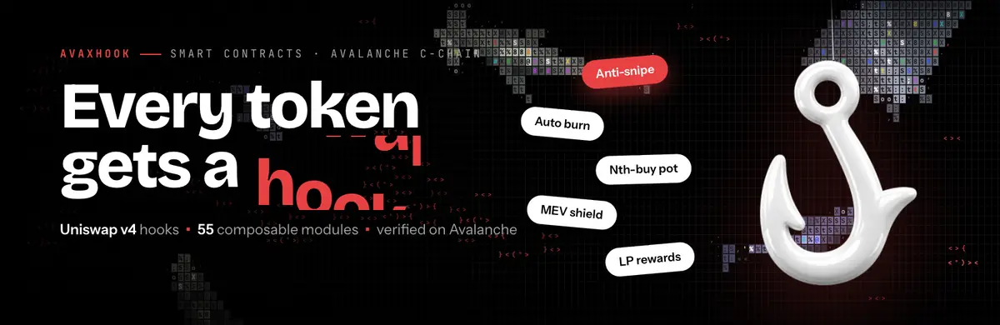

<div align="center">

<a href=".github/assets/banner.webm"></a>

<br>

**A launchpad where every token gets its own rules, enforced on every swap by a Uniswap v4 hook on Avalanche.**

<br>

[](https://avaxhook.fun)
[](https://x.com/avaxhookfun)
[](https://snowtrace.io)


[**How it works**](#how-it-works) · [**Deployments**](#deployments--avalanche-c-chain-43114) · [**Hook modules**](#hook-modules) · [**Build & test**](#build--test) · [**Security**](#security)

</div>

---

Every token launched on Avax Hook starts on a bonding curve and **graduates into a Uniswap v4 pool** whose
hook enforces that token's own rules. The creator picks the rules at launch from a library of
**55 composable hook modules** (anti-snipe, auto-burn, holder dividends, market hours, jackpots, arcade games…),
and they keep running on every swap once the token reaches the pool.

All contracts in this repository are **deployed on Avalanche mainnet and verified** on Snowtrace / Routescan.
This repo has the exact sources, compiler settings and pinned dependencies, so anyone can rebuild the
bytecode and check it against the chain.

## How it works

```
             launch (pick modules + config)
creator ───────────────────────────────────────► HookLaunchpadV2
                                                     │  mints a 1B-supply HookToken
                                                     ▼
                     ┌───────────────── bonding curve ─────────────────┐
  buyers / sellers ─►│ starts at $2,500 market cap, graduates at $50k  │
                     └─────────────────────────┬───────────────────────┘
                                               │ graduation
                                               ▼
                         Uniswap v4 pool  ◄──►  AvaxHookV2 (the hook)
                                                     │ beforeSwap / afterSwap /
                                                     │ liquidity / transfer callbacks
                                                     ▼
                                    HookModuleRegistry → enabled modules
                                    (each token: its own set + config)
```

- **Quote assets.** Launches can be priced in AVAX, USDC, USDt, a set of Avalanche ecosystem coins, and
  Avalanche L1 gas tokens. `QuoteRegistry` turns USD market-cap targets into quote amounts using pull-model
  `SignedPriceFeed`s, with staleness and bound checks.
- **Fees.** 0.3% protocol fee, a creator fee of 0–10% and a base pool fee of 0–10%, chosen at launch.
- **Modules.** Modules are independent contracts that register for hook capabilities (swap, liquidity,
  transfer). The registry enforces capability flags and conflict groups, so incompatible rules can't be
  combined on one token.
- **Ownership.** Admin roles are held by a 2-of-3 Safe multisig, not by an EOA.

## Stacks

| Stack | Status | What changed |
|---|---|---|
| **v3** | **Current, used for all new launches** | `HookTokenV3`: tokens can be transferred freely during the curve phase. All other contracts are the unchanged v2 sources, deployed again. |
| v2 | Live (older tokens) | Modular hook + module registry, zap, limit orders, blueprints, arcade. |
| Pools | Live | `AvaxHookPoolsV1`: rule-enforcing v4 pools for **existing** tokens, opened through `PoolCoordinatorV1`. |
| v1 | Legacy | First launchpad with one hook per token. |
| Stock bridge | Live | Robinhood Chain escrow → bridged stocks (mStocks) on Avalanche, plus a capital-free `StockZap`. |

## Deployments — Avalanche C-Chain (43114)

### v3 (current)

| Contract | Address |
|---|---|
| AvaxHookV2 | [`0xfd0753147e21c3f61e38ae27d6634b8c38cb6acc`](https://snowtrace.io/address/0xfd0753147e21c3f61e38ae27d6634b8c38cb6acc#code) |
| HookLaunchpadV2 | [`0xd4c28ec86daa5227ce6548d42d2deb890d3c99e1`](https://snowtrace.io/address/0xd4c28ec86daa5227ce6548d42d2deb890d3c99e1#code) |
| HookTokenFactoryV3 | [`0x95d1a6e98b5be5104ae065d213f7acf91259e7fa`](https://snowtrace.io/address/0x95d1a6e98b5be5104ae065d213f7acf91259e7fa#code) |
| AvaxHookRouterV2 | [`0xeeb024bf09aa1c962139bcfe8b964cd9e496b7e6`](https://snowtrace.io/address/0xeeb024bf09aa1c962139bcfe8b964cd9e496b7e6#code) |
| HookLensV2 | [`0xe9adf1f14549fcad4df5492f1146e1790c80b1c5`](https://snowtrace.io/address/0xe9adf1f14549fcad4df5492f1146e1790c80b1c5#code) |
| HookModuleRegistry | [`0xaa3e014d55e5007796d598617061c07d71f2abc7`](https://snowtrace.io/address/0xaa3e014d55e5007796d598617061c07d71f2abc7#code) |
| AvaxHookZap | [`0xd6e66656eb8d23084aaf5d8962d5120e8b3ad3eb`](https://snowtrace.io/address/0xd6e66656eb8d23084aaf5d8962d5120e8b3ad3eb#code) |
| AvaxHookZapV62 | [`0x2510d6770Fc11Cc6885aFf2a43707395a56bA306`](https://snowtrace.io/address/0x2510d6770Fc11Cc6885aFf2a43707395a56bA306#code) |
| AvaxHookLimitOrders | [`0x6Ce3a6029F2c289bde485e20287E88Fb56dE27F9`](https://snowtrace.io/address/0x6Ce3a6029F2c289bde485e20287E88Fb56dE27F9#code) |
| PlayableSplitBuyer | [`0xe396F0b1C8dE17618fBD8fCEa9a51316CCFab5C5`](https://snowtrace.io/address/0xe396F0b1C8dE17618fBD8fCEa9a51316CCFab5C5#code) |
| QuoteRegistry (shared) | [`0xaED8702bD08FA20d6e49B09AcE6fa2E20cbF6FF1`](https://snowtrace.io/address/0xaED8702bD08FA20d6e49B09AcE6fa2E20cbF6FF1#code) |
| ProtocolTreasury | [`0xAC3ABB7902764c5202FB832b3292c75d5a36f6fE`](https://snowtrace.io/address/0xAC3ABB7902764c5202FB832b3292c75d5a36f6fE#code) |

### v2

| Contract | Address |
|---|---|
| AvaxHookV2 | [`0x179278C7ECD2cFbc003D76985Ba05f11DDc36ACc`](https://snowtrace.io/address/0x179278C7ECD2cFbc003D76985Ba05f11DDc36ACc#code) |
| HookLaunchpadV2 | [`0x922A73Bd8aC4db8729aADE7a09288Da536058F02`](https://snowtrace.io/address/0x922A73Bd8aC4db8729aADE7a09288Da536058F02#code) |
| HookTokenFactoryV2 | [`0x418F365a75B2FCB1ce086F0Ee9c19c975087f61E`](https://snowtrace.io/address/0x418F365a75B2FCB1ce086F0Ee9c19c975087f61E#code) |
| AvaxHookRouterV2 | [`0xC8B2b67A1E286f74648A705617d54a0415fc651a`](https://snowtrace.io/address/0xC8B2b67A1E286f74648A705617d54a0415fc651a#code) |
| HookLensV2 | [`0xd6Edfc43c10b83eC7Aed4d26fd25F4ad57258398`](https://snowtrace.io/address/0xd6Edfc43c10b83eC7Aed4d26fd25F4ad57258398#code) |
| HookModuleRegistry | [`0xA84Eb2215c88e76048552471E1a486Ae68762286`](https://snowtrace.io/address/0xA84Eb2215c88e76048552471E1a486Ae68762286#code) |
| AvaxHookZap | [`0x9C608BAeE175F3faaB83D18a6a805379043e990d`](https://snowtrace.io/address/0x9C608BAeE175F3faaB83D18a6a805379043e990d#code) |
| AvaxHookZapV62 | [`0x68144bE523868ED1Bc29F58d440cB62447190A1a`](https://snowtrace.io/address/0x68144bE523868ED1Bc29F58d440cB62447190A1a#code) |
| AvaxHookLimitOrders | [`0xBB324987e484B1C03A41632fE6eE40D6544d80dc`](https://snowtrace.io/address/0xBB324987e484B1C03A41632fE6eE40D6544d80dc#code) |
| BlueprintRegistryV1 | [`0x79114a00eA631b8F0fD83C2D6B060e883e7f8717`](https://snowtrace.io/address/0x79114a00eA631b8F0fD83C2D6B060e883e7f8717#code) |
| ArcadeScores | [`0xF2FB487D5e638d6C04ba2B004C0E564Bcc7388Ab`](https://snowtrace.io/address/0xF2FB487D5e638d6C04ba2B004C0E564Bcc7388Ab#code) |
| Arcade game: LightsOut | [`0x08c7E78514dfea0bC3c86B83Cd278cA4a6fB8123`](https://snowtrace.io/address/0x08c7E78514dfea0bC3c86B83Cd278cA4a6fB8123#code) |
| Arcade game: 2048 | [`0xc60a02eF3434094C8ea9Bdcc2a72241c6a152965`](https://snowtrace.io/address/0xc60a02eF3434094C8ea9Bdcc2a72241c6a152965#code) |

### Pools (existing tokens)

| Contract | Address |
|---|---|
| AvaxHookPoolsV1 (hook) | [`0x5aee0417293a175108124d462E5c10D400f6aaCC`](https://snowtrace.io/address/0x5aee0417293a175108124d462E5c10D400f6aaCC#code) |
| PoolCoordinatorV1 | [`0x328BC346ff3253c0E79Dd85CEB0398731568012E`](https://snowtrace.io/address/0x328BC346ff3253c0E79Dd85CEB0398731568012E#code) |
| PoolRouterV1 | [`0xEdcE6bE8eB219B6EebB7d3C3620356273a1B748d`](https://snowtrace.io/address/0xEdcE6bE8eB219B6EebB7d3C3620356273a1B748d#code) |
| HookModuleRegistry | [`0xAc1B5D117FDcaeEe970Fa227ED5F55F93E7493D8`](https://snowtrace.io/address/0xAc1B5D117FDcaeEe970Fa227ED5F55F93E7493D8#code) |

### v1 (legacy)

| Contract | Address |
|---|---|
| AvaxHook | [`0x34208F34e00ffbbB47c951230B794C4afB12e8cC`](https://snowtrace.io/address/0x34208F34e00ffbbB47c951230B794C4afB12e8cC#code) |
| HookTokenFactory | [`0xcE7e33236FeB2834d8aEeD42c41B137E977dCB57`](https://snowtrace.io/address/0xcE7e33236FeB2834d8aEeD42c41B137E977dCB57#code) |
| HookLaunchpad | [`0xB74a29Fce14D06cF941c3034caD7a68F1a9e37Fe`](https://snowtrace.io/address/0xB74a29Fce14D06cF941c3034caD7a68F1a9e37Fe#code) |
| AvaxHookRouter | [`0xfc0F98366582Fc4013890A46BDf460d1cC85239f`](https://snowtrace.io/address/0xfc0F98366582Fc4013890A46BDf460d1cC85239f#code) |
| HookLens | [`0xe984A0014A1371e4A791302b2030e2A60504a5ac`](https://snowtrace.io/address/0xe984A0014A1371e4A791302b2030e2A60504a5ac#code) |
| QuoteRegistry | [`0xaED8702bD08FA20d6e49B09AcE6fa2E20cbF6FF1`](https://snowtrace.io/address/0xaED8702bD08FA20d6e49B09AcE6fa2E20cbF6FF1#code) |

### Stock bridge

| Contract | Chain | Address |
|---|---|---|
| StockGateway | Avalanche | [`0xCf8d728BCE9f2E489e11c0865eca977eFa5cc657`](https://snowtrace.io/address/0xCf8d728BCE9f2E489e11c0865eca977eFa5cc657#code) |
| StockEscrow | Robinhood Chain | `0xa5D1615cd93D64F74B2eD39fB9c3D79216657613` |
| StockZap | Robinhood Chain | `0xa151Fa44a1ea73f9b8F1EeD191890d6f8316504C` |

The full machine-readable address lists (every module, per stack) are in
[`script/v3-state.json`](script/v3-state.json), [`script/v2-state.json`](script/v2-state.json),
[`script/pools-state.json`](script/pools-state.json), [`script/deploy-state.json`](script/deploy-state.json)
and [`script/bridge-state.json`](script/bridge-state.json).

## Hook modules

IDs 1–55 are shared by v2 and v3; IDs 56–79 are v3-only redeployments that replace older IDs (now deprecated). Addresses below are the v3 deployments; v2 addresses are in
[`script/v2-state.json`](script/v2-state.json).

<details open>
<summary><b>Module list</b></summary>

| ID | Module | What it does | Category | v3 address |
|---:|---|---|---|---|
| 59 | **Anti-snipe** | Caps buys per block and taxes bots at the pool open. | protection | [`0x0104…420d`](https://snowtrace.io/address/0x0104970c7b3bd17e6d555a0944413a44a2ea420d#code) |
| 2 | **Auto burn** | A slice of every buy is burned forever. | rewards | [`0xef5c…81ee`](https://snowtrace.io/address/0xef5c5240b7344729d18f96cec8bedc45d40c81ee#code) |
| 3 | **Beacon** | Records the token's all-time-high market cap so other tokens can react to it. | linked | [`0xa53a…68dc`](https://snowtrace.io/address/0xa53a6355aac8b0ea46666090afa85fcf640b68dc#code) |
| 4 | **Breathing cap** | The max buy breathes in and out on a fixed clock. | buy-cap | [`0xd0db…eccb`](https://snowtrace.io/address/0xd0db5c00f284cef9e764191032f75313bc85eccb#code) |
| 5 | **Buyback & burn** | Sells fund buybacks that burn the token. | rewards | [`0x024d…3e27`](https://snowtrace.io/address/0x024d4ee134b1d3c23a80969540c26bd9842a3e27#code) |
| 6 | **Buyer rewards** | Every qualifying buy earns a fixed reward from a vault you fill. | rewards | [`0x03ad…4253`](https://snowtrace.io/address/0x03ad7808ad792dd70722462c7640e499e69f4253#code) |
| 7 | **Dump guard** | No transaction sells more than a slice of supply, early on. | protection | [`0x2b6e…4d23`](https://snowtrace.io/address/0x2b6ee0e9d9fc28c5606a6d450cd753e717404d23#code) |
| 62 | **Dynamic fee** | Big trades pay more, small trades pay the base. | fees | [`0x2840…64c7`](https://snowtrace.io/address/0x2840fe8fbb3ab10fe8db56ec9d3ec8ee723264c7#code) |
| 9 | **Entangled** | Locked until another token's market cap reaches a target, then free forever. | linked | [`0x4e74…08c6`](https://snowtrace.io/address/0x4e74d9461d6edc9f36eb20e2274169188ab608c6#code) |
| 10 | **Hot potato** | The last big buyer can't sell until someone else buys after them. | sell-lock | [`0x9369…d068`](https://snowtrace.io/address/0x93692f8281c3a9bc188c390f85bd0342fdf9d068#code) |
| 11 | **King of the Hill** | The biggest buy wears the crown and earns from every trade. | rewards | [`0xaa14…6c01`](https://snowtrace.io/address/0xaa14b38fa2dd876b3ae35b1127591a250b086c01#code) |
| 12 | **Last-buyer pot** | If nobody buys for a while, the last buyer wins. | rewards | [`0xb608…e250`](https://snowtrace.io/address/0xb6081c50339eddc4a8e19b5950acca9d59b5e250#code) |
| 13 | **LP rewards** | A slice of every buy is paid to liquidity. | rewards | [`0x13f1…24c1`](https://snowtrace.io/address/0x13f1e95f3f7e344bcafc24d370cae646711324c1#code) |
| 14 | **Market hours** | Trades only while Wall Street is open. After hours, nothing trades. | schedule | [`0xa0bf…5d3e`](https://snowtrace.io/address/0xa0bf47ecfdc7a903139277148185c0764dea5d3e#code) |
| 15 | **Market hours (sells always open)** | Buys only while Wall Street is open. Sells stay open around the clock. | schedule | [`0x51f9…686a`](https://snowtrace.io/address/0x51f919863f71aa123ebf76b58a2338d38f1e686a#code) |
| 77 | **Max per wallet** | No wallet can hold more than a slice of supply. | protection | [`0xcd93…97d8`](https://snowtrace.io/address/0xcd93432b75ed1e0cb079366aa0b3c6cedd9897d8#code) |
| 17 | **MEV shield** | Refuses swaps that bribe their way to the front. | protection | [`0x5887…84a6`](https://snowtrace.io/address/0x5887b8868ed034a99f97bbc42318e2277fd984a6#code) |
| 66 | **Momentum** | Every buy kicks a spring that sets how big the next buy can be. | buy-cap | [`0x5c90…9437`](https://snowtrace.io/address/0x5c90d00b9adf5590a9e59f38966ef41bc6c59437#code) |
| 19 | **Nth-buy pot** | Buys fill a pot. Every Nth buy takes it. | rewards | [`0x8392…39f9`](https://snowtrace.io/address/0x839284ca49df7ed78bdbcec3810d0dd80cce39f9#code) |
| 20 | **Ping pong** | Buys and sells take turns, for everyone. | turns | [`0xe14e…6e75`](https://snowtrace.io/address/0xe14e75d596fb90da81999d60bb8aa455053c6e75#code) |
| 21 | **Referral** | Whoever brings a buyer earns part of your pool fee. | fees | [`0x151a…a52f`](https://snowtrace.io/address/0x151a354b9872bba556d60b46c414c9edd3bca52f#code) |
| 22 | **Sell tax decay** | Early sells pay extra; the tax fades to zero. | protection | [`0x6d64…84a4`](https://snowtrace.io/address/0x6d6474708d2bb9c6d61cd65255b60170877a84a4#code) |
| 23 | **Sliding caps** | Max buy and max sell loosen as the market cap grows. | trade-cap | [`0x460c…89da`](https://snowtrace.io/address/0x460c0c96f0195d66c014a18047e357c6c7f289da#code) |
| 24 | **Tithe** | A fixed share of every trade goes to a cause you name. | fees | [`0xe1e0…6d3f`](https://snowtrace.io/address/0xe1e075b6d12331e88a3355e52eb8e0298a006d3f#code) |
| 25 | **Volatility fee** | Chasing a move inside one block costs extra. | fees | [`0x2821…bb6c`](https://snowtrace.io/address/0x2821172fb037627ad6bdea18140c05dad7f6bb6c#code) |
| 26 | **Whale guard** | No transaction buys more than a set size, early on. | protection | [`0x41d5…d838`](https://snowtrace.io/address/0x41d5be74151b0f093e4b2b45644ad7a07d26d838#code) |
| 27 | **Auto-LP** | A slice of every trade becomes locked liquidity. | rewards | [`0xcefe…aa99`](https://snowtrace.io/address/0xcefe6440db2f8d459241953d9ffdd0d9c1b8aa99#code) |
| 64 | **Holder dividends** | A share of every trade is paid to holders, pro-rata to their balance. | rewards | [`0x2167…945e`](https://snowtrace.io/address/0x2167dac4d886d6e98ab592e0e3f1a9e32d43945e#code) |
| 29 | **Blueprint royalty** | Added automatically when you launch from a marketplace blueprint: pays its author a share of every trade. | fees | [`0xfca9…d96f`](https://snowtrace.io/address/0xfca91a435d7e87f0b78882ccb022fe5b8374d96f#code) |
| 30 | **Partner fee** | Added automatically to tokens launched through a partner bot: pays the partner a share of every trade. | fees | [`0xfc33…dcf7`](https://snowtrace.io/address/0xfc338a096089786505adb15f68e74bb28a8bdcf7#code) |
| 68 | **Alliances** | Token diplomacy: allies' holders skip the cap, rivals' holders can't buy. | linked | [`0xb183…aa48`](https://snowtrace.io/address/0xb1831e5485f585863cc7d1082f191a58dd5eaa48#code) |
| 69 | **Allowlist** | Only approved wallets can buy or receive the token. | protection | [`0x7505…b60a`](https://snowtrace.io/address/0x7505ab3003a471551261211d8199cce73fc1b60a#code) |
| 58 | **Anti-bundle** | Only a few buys per block, so a bundle can't sweep the launch. | protection | [`0xd632…414d`](https://snowtrace.io/address/0xd6322f06f45ca2235578bc987548b5b2e674414d#code) |
| 34 | **Arcade** | Hold more by beating the coin's game. | protection | [`0x54e3…e02d`](https://snowtrace.io/address/0x54e33ea334ba15434d599299d0bcc725e5dee02d#code) |
| 35 | **Block zero** | The creator gets the first blocks to themselves. | protection | [`0xd007…85eb`](https://snowtrace.io/address/0xd007e2ee5c9335e30ab7e74af8c879ff2e9085eb#code) |
| 70 | **Blocklist** | Named wallets can never buy or receive the token. | protection | [`0x1ff9…4edf`](https://snowtrace.io/address/0x1ff97eeb56c36659d3d0f955727d36e3ced74edf#code) |
| 71 | **Chapters** | Max per wallet doubles every time trading volume crosses another chapter. | protection | [`0x3720…4387`](https://snowtrace.io/address/0x3720f958055c8e5241916650a24d8bb283344387#code) |
| 72 | **Conviction cap** | The longer a wallet holds without selling, the bigger it may buy. | buy-cap | [`0xcf78…bfea`](https://snowtrace.io/address/0xcf7844a918f17e2fe7f2ff1a5a69dbdd90a4bfea#code) |
| 61 | **Coupled resonator** | Two linked springs: the buy cap swells and fades in waves. | buy-cap | [`0x419c…ed20`](https://snowtrace.io/address/0x419c8324bb5917dd711a819f4e15b9fadb36ed20#code) |
| 40 | **DEX-only** | Swaps only: no wallet-to-wallet sends. | protection | [`0xf39a…1c74`](https://snowtrace.io/address/0xf39a455eea324116bb192aeaf8031fab910b1c74#code) |
| 73 | **Graduated sell caps** | The bigger your bag, the smaller the slice you can sell at once. | protection | [`0xa289…4f42`](https://snowtrace.io/address/0xa28929fbb3676a0ccf3e3fbb6c6ade5947bc4f42#code) |
| 74 | **The grudge** | The token remembers dumpers and makes them wait. | protection | [`0x45bd…7a71`](https://snowtrace.io/address/0x45bd5efa9f2be41603333fe19c37f91a63577a71#code) |
| 75 | **Holder-gated** | Only holders of a chosen token can buy or receive it. | protection | [`0x8efe…23e7`](https://snowtrace.io/address/0x8efea6cdcecba0ccc8617917eedcbdabba4523e7#code) |
| 76 | **Holder vesting** | Early buys unlock step by step after a cliff. | sell-lock | [`0x4b18…e89b`](https://snowtrace.io/address/0x4b18efcf00ae695f20c35619db38d1c2dfe3e89b#code) |
| 45 | **Quantum jackpot** | Trades fill a pot. Every round one ticket wins it, weighted by what you bought. | rewards | [`0xc3e4…a0b4`](https://snowtrace.io/address/0xc3e4697d2a1b32245887435314be48d45011a0b4#code) |
| 46 | **Lock & earn** | Lock tokens in your wallet and earn a share of every trade. | rewards | [`0xc77d…93b6`](https://snowtrace.io/address/0xc77d2b9e8df1634081c7e04f35c7d9c8247f93b6#code) |
| 47 | **P2P-only** | After graduation, a wallet-to-wallet-only period before the pool opens for trading. | schedule | [`0x6eb8…e3cc`](https://snowtrace.io/address/0x6eb836983bc4bd25ffecd6429df3cd16cf25e3cc#code) |
| 78 | **Plague** | After graduation you can only buy once an infected holder has sent you tokens. | protection | [`0x29d4…f4a1`](https://snowtrace.io/address/0x29d4e7443be191a4f2627f23e92f852fea93f4a1#code) |
| 49 | **Polarity** | Two coins, one price: BULL and BEAR pots that move with the market. | linked | [`0xf663…111b`](https://snowtrace.io/address/0xf6639817f70f9cb38f16f0f6fe18be5ab08b111b#code) |
| 50 | **Reactive pair** | Two tokens linked: buying one opens the other's buy cap. | linked | [`0x213f…92ff`](https://snowtrace.io/address/0x213fd18cd7645ba3f5587babab4fdc67717f92ff#code) |
| 51 | **Red light, green light** | Trading switches on and off at random-looking moments. | schedule | [`0xc428…7833`](https://snowtrace.io/address/0xc42859b324d0c065a2e5155c39260369ac197833#code) |
| 52 | **Resonance** | Buy on the beat and the cap swings wider for everyone. | buy-cap | [`0xf425…06eb`](https://snowtrace.io/address/0xf425be5396e9590a5bd507ac04b727cc3b8106eb#code) |
| 53 | **Rising floor** | A share of every trade backs a floor price any holder can redeem at. | rewards | [`0x0a45…9db7`](https://snowtrace.io/address/0x0a450b75880f38396ef9584e66d93ddcdf149db7#code) |
| 79 | **Rising max per wallet** | Max per wallet rises for everyone on a timer until there is no cap. | protection | [`0x18df…e465`](https://snowtrace.io/address/0x18df110b6584614fa1fcd1634b6d073c2090e465#code) |
| 55 | **Underwater** | A share of every trade partly refunds holders who are below what they paid. | rewards | [`0x7cdb…2d47`](https://snowtrace.io/address/0x7cdbcee2eb00e2e161013a24fa13ecb99ff62d47#code) |
</details>

## Repository layout

```
contracts/
├── AvaxHook.sol, HookLaunchpad.sol, …   v1 launchpad, hook, router, lens
├── QuoteRegistry.sol, SignedPriceFeed.sol   quote assets + signed USD price feeds
├── v2/
│   ├── AvaxHookV2.sol                    the modular Uniswap v4 hook
│   ├── HookLaunchpadV2.sol               bonding curve + graduation
│   ├── HookModuleRegistry.sol            module ids, capabilities, conflict groups
│   ├── AvaxHookRouterV2.sol, AvaxHookZap.sol, AvaxHookLimitOrders.sol
│   ├── modules/                          the 55 hook modules + shared bases and libs
│   ├── pools/                            rule-enforcing pools for existing tokens
│   ├── blueprints/                       on-chain module presets
│   └── arcade/                           on-chain games used by the Arcade module
├── v3/                                   HookTokenV3 + factory (free curve-phase transfers)
├── bridge/                               Robinhood Chain ↔ Avalanche stock bridge
└── stock/                                StockOrders (written, not deployed)
script/                                   Foundry deploy scripts + deployed address files
test/                                     unit, regression and mainnet-fork tests
```

## Build & test

Requires [Foundry](https://book.getfoundry.sh/getting-started/installation).

```bash
git clone --recursive https://github.com/Avax-Hook/Avax-Hook.git
cd Avax-Hook
forge build
forge test
```

If you cloned without `--recursive`, run `git submodule update --init --recursive`.

Fork tests (`*Fork.t.sol`) need an Avalanche RPC:

```bash
AVALANCHE_RPC_URL=https://api.avax.network/ext/bc/C/rpc forge test --match-path 'test/*Fork*'
```

The build uses `solc 0.8.26`, `via_ir = true`, 200 optimizer runs and `evm_version = cancun`, the same
settings used for the verified deployments. Dependencies are pinned git submodules:

| Library | Version |
|---|---|
| Uniswap v4-core | `a7cf038` (v4.0.0 + 11) |
| Uniswap v4-periphery | `9969eec` |
| OpenZeppelin Contracts | v5.1.0 |
| forge-std | v1.17.0 |

## Security

- Every deployed contract is verified on [Snowtrace](https://snowtrace.io) / Routescan.
- Admin roles are held by a 2-of-3 Safe multisig.
- Security fixes of 2026-11-10 (12 modules redeployed as ids 56–67, the old ids deprecated, a new
  PlayableSplitBuyer; source-only fixes for contracts that ship with the next deployment):
  [`docs/security-2026-11.md`](docs/security-2026-11.md).
- Transfer-rule fix of 2026-11-12: 12 transfer-rule modules redeployed as ids 68–79; while their rule is active they only accept
  pool swaps through the AvaxHook router. The previous ids are deprecated.
- Audit findings and their fixes are covered by regression tests in [`test/AuditRegressions.t.sol`](test/AuditRegressions.t.sol);
  the pools-specific fixes are documented in [`contracts/v2/pools/README.md`](contracts/v2/pools/README.md).

Found a vulnerability? Please **don't open a public issue**. Report it privately through
[GitHub Security Advisories](https://github.com/Avax-Hook/Avax-Hook/security/advisories/new).

## License

[MIT](LICENSE)

---

<div align="center">
<a href="https://avaxhook.fun"></a>
<br><br>
<sub><b>Avax Hook</b> · Every token gets a hook. · <a href="https://avaxhook.fun">avaxhook.fun</a> · <a href="https://x.com/avaxhookfun">@avaxhookfun</a></sub>
</div>
